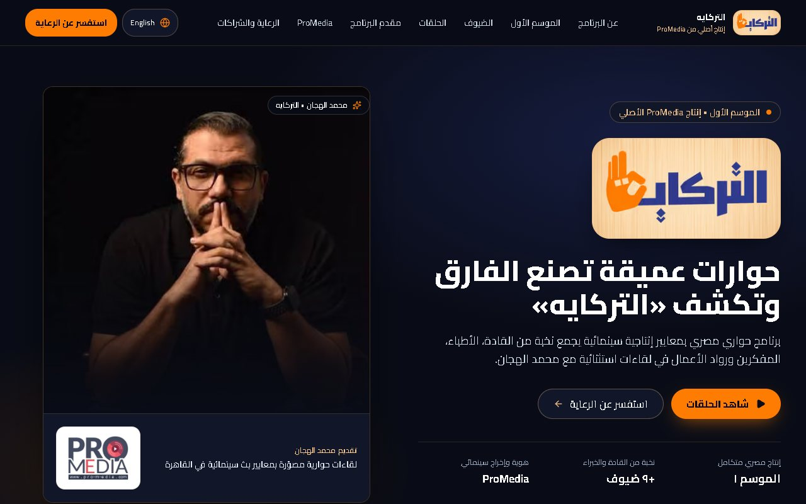

# El Turkaya (التركاية) — Official Talk Show Hub & Sponsorship Platform

**الموقع الرسمي ومنصة الرعايات والحلقات لبرنامج «التركاية» — تقديم محمد الهجان وإنتاج ProMedia**



🌐 **Live Production Website:** [el-turkaya.vercel.app](https://el-turkaya.vercel.app/)  
🏢 **Production & Media Ecosystem:** **ProMedia**  
👨‍💻 **Digital Engineering & Project Execution:** [Mostafa Mohamed Farhat (Elshorbagy)](https://mostafa-portfolio-iota.vercel.app/)

---

## Overview

**El Turkaya (التركاية)** is the official Season 1 digital platform, episode archive, guest showcase, and commercial sponsorship hub for the Egyptian talk show hosted by **Mohamed Elhagan** and produced by **ProMedia**.

### Key Features
- **Season 1 Episode Library:** Categorized episode cards with guest highlights, topics, and direct playback access.
- **Featured Guest Directory:** Editorial showcase of prominent guests across medicine, entrepreneurship, public speaking, and media.
- **B2B Sponsorship & Partnership Hub:** Structured commercial positioning and direct sponsorship inquiry flow for brand partners.
- **Bilingual Arabic RTL / English Experience:** Native Arabic right-to-left typography paired with responsive dark studio aesthetics.

---

## Tech Stack
- **Framework:** Next.js (App Router) + React 19 + TypeScript
- **Styling & Motion:** Tailwind CSS + Framer Motion
- **Deployment:** Vercel Edge Network

---

## Local Development

```bash
# Install dependencies
npm install

# Start development server
npm run dev

# Build for production
npm run build
```
